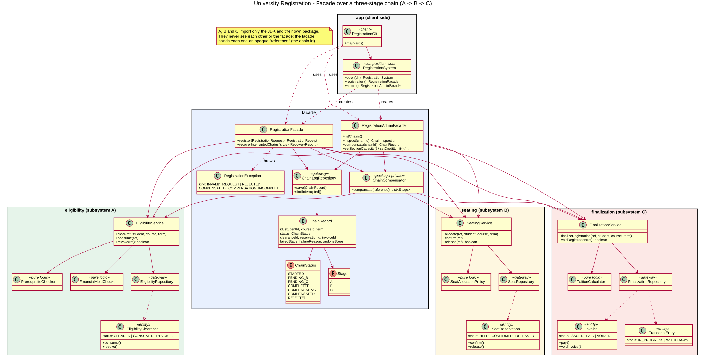

# University Registration - a Facade over a three-stage chain

Assignment 4 (Facade, persistence, live demo). Domain: **University Registration**.
One logical operation for the client, "register this student for this course", drives three independent
subsystems in a fixed order and keeps the data consistent even when the chain breaks in the middle.

| Step | Subsystem | Package | What it does |
|------|-----------|---------|--------------|
| **A** | Eligibility (intake / reservation) | `eligibility` | Checks prerequisites and financial hold, then **reserves** the right to take the course (a persisted *clearance*). |
| **B** | Seating (processing / execution) | `seating` | Holds one **seat** in the course section (capacity, open/closed). |
| **C** | Finalization (finalization / confirmation) | `finalization` | Issues the tuition **invoice** and writes the course on the **transcript**, in one transaction. |

Java 17+, Maven, embedded **H2** database files (no server, nothing to install), JUnit 5, JaCoCo.

---

## 1. Build, run, test (one command each)

```bash
mvn -q compile exec:java                          # run the demo (data kept in ./data, survives restarts)
mvn -q compile exec:java -Dexec.args="--reset"    # run the demo on freshly reset demo data
mvn test                                          # all tests + coverage report (target/site/jacoco/index.html)
mvn verify                                        # same, and fails the build below 80 % line coverage
mvn package && java -jar target/university-registration.jar   # runnable fat jar
```

**IntelliJ IDEA:** `File > Open` and pick `pom.xml` (Open as Project). Wait for the Maven import, make sure the
project SDK is JDK 17 or newer. Run `kz.aitu.registration.app.RegistrationCli` (right-click, *Run*) for the demo,
and right-click `src/test/java` > *Run Tests* (or *Run with Coverage*) for the tests. The demo reads and writes the
`data/` folder in the project root. To pass `--reset`: *Run > Edit Configurations > Program arguments*.

### Resetting the persisted store to a clean state
Any one of:
1. start with `--reset` (see above), or
2. menu item **14** inside the running demo (asks for `YES`), or
3. stop the app and delete the `data/` folder (the demo data is re-created on the next start).

Only one copy of the application may use a `data/` folder at a time (H2 locks its files).

---

## 2. Live demo cheat-sheet (menu of the CLI)

The demo university is loaded automatically. Students: **S1001** Aibek (rich), **S1002** Dana (credit limit only
100 000 KZT), **S1003** Ermek (never passed CS201), **S1004** Aigerim (owes 150 000 KZT), **S1005** Timur (50 % scholarship).
Courses of term `2026-FALL`: CS201 (40 seats), CS301 (25), **CS350 (exactly 1 seat)**, **CS399 (0 seats)**.

| Goal | Menu | What you see |
|------|------|--------------|
| Whole chain A -> B -> C | **1**: `S1001`, `CS301` | chain `COMPLETED`; A `CONSUMED`, B `CONFIRMED`, C invoice `ISSUED` + transcript `IN_PROGRESS` |
| **B fails after A committed** (compensate A alone) | **8** (or **1**: `S1001`, `CS399`; or fill `CS350` with one student and register a second) | `FAIL [COMPENSATED] ... step B ... SECTION_FULL`, *undone in this order: [A]*, A `REVOKED`, B and C hold nothing |
| **C fails after A and B committed** (compensate B, then A) | **9** (or **1**: `S1002`, `CS301`; or menu **13** to close the billing office) | `... step C ... LIMIT_EXCEEDED`, *undone in this order: [B, A]*, A `REVOKED`, B `RELEASED`, seat is free again |
| A refuses (nothing committed, nothing to undo) | **10** (`S1003`), or `S1004` for the financial hold | `FAIL [REJECTED] ... step A`, chain `REJECTED`, A/B/C empty |
| Invalid input | **1** with an empty student id | `FAIL [INVALID_REQUEST]`, no chain is even created |
| Inspect persisted state at any time | **2** list chains, **3** inspect one, **4** students and sections, **5** transcript | each subsystem's *real* stored state next to the facade's log |
| Manual compensation (admin facade) | **6** | cancels any chain, also a `COMPLETED` one: *C, then B, then A* |
| Provoke your own failure | **11** capacity / open-close, **12** credit limit / debt, **13** billing office | next registration meets the staged situation |
| Restart | exit with **0**, start again | everything is read back from disk; interrupted chains are recovered at start-up |

---

## 3. Architecture



`docs/uml-class-diagram.svg` / `.png` (source: `.puml`). The life-cycle of a chain is in `docs/chain-state-diagram.svg`.

### 3.1 Subsystems (each 4-5 classes, 14 in total, nested enums/exceptions not counted)

| | Pure business logic | Entity with status + guarded transitions | Persistence gateway | Entry point |
|---|---|---|---|---|
| **A** | `PrerequisiteChecker`, `FinancialHoldChecker` | `EligibilityClearance`: `CLEARED` -> `CONSUMED`, `CLEARED/CONSUMED` -> `REVOKED` | `EligibilityRepository` | `EligibilityService` |
| **B** | `SeatAllocationPolicy` | `SeatReservation`: `HELD` -> `CONFIRMED`, `HELD/CONFIRMED` -> `RELEASED` | `SeatRepository` | `SeatingService` |
| **C** | `TuitionCalculator` | `Invoice`: `ISSUED` -> `PAID`, `ISSUED/PAID` -> `VOIDED`; `TranscriptEntry`: `IN_PROGRESS` -> `WITHDRAWN` | `FinalizationRepository` | `FinalizationService` |

* Every entity refuses illegal transitions **itself** (`IllegalTransitionException`), no matter who calls it.
* A, B, C import only the JDK and their own package. `SubsystemIndependenceTest` reads the source files and fails if
  that ever changes. They meet only inside the facade.
* They are usable on their own: every subsystem has standalone tests, and `StandaloneSubsystemsDemo.main` runs
  each one without facade and without the others.
* The facade hands every subsystem an opaque **`reference`** (the chain id). A subsystem only uses it as an
  idempotency key; it does not know what it means. That is what lets the facade find "its" records later.

### 3.2 Two facades
* `RegistrationFacade` (everyday): `register(...)` contains the real sequencing, logging and decision logic;
  `recoverInterruptedChains()` runs after every start.
* `RegistrationAdminFacade` (narrow, administrative): list/inspect chains (what A, B and C really hold), manual
  compensation (also of completed chains), and "staging" operations (capacity, credit limit, debt, billing office)
  to provoke failures on demand.

### 3.3 Durable state
Four embedded H2 database files, **one per subsystem plus the facade's own chain log**:
`data/eligibility.mv.db`, `data/seating.mv.db`, `data/finalization.mv.db`, `data/facade.mv.db`.
Every commit is flushed immediately (`WRITE_DELAY=0`). The chain log holds `STARTED, PENDING_B, PENDING_C, COMPLETED,
COMPENSATING, COMPENSATED, REJECTED`.

### 3.4 How the chain and the compensation work

```
log STARTED
  A.clear(ref)            -> log PENDING_B       fails: REJECTED, nothing to undo
  B.allocate(ref)         -> log PENDING_C       fails: compensate -> A
  C.finalize(ref)                                fails: compensate -> B, then A
  B.confirm(ref); A.consume(ref)  -> log COMPLETED
```
* **Compensation reads the disk, not a flag.** `ChainCompensator` asks each subsystem *by reference* whether it
  really holds committed state for the chain and undoes exactly that, newest first (C, B, A). Each undo is
  idempotent and reports whether it changed anything. So a failure at B undoes only A (B and C hold nothing),
  a failure at C undoes B then A, and repeating an interrupted undo is harmless.
* A failed step in B or C leaves nothing behind in its own store: allocation and finalization are single
  transactions (C writes the invoice **and** the transcript line atomically).
* **Restart recovery** (`recoverInterruptedChains`) looks at every chain whose log status is not final and at what
  A, B and C actually hold: if all three committed it rolls **forward** to `COMPLETED` (confirm B, consume A),
  otherwise it rolls **back** whatever was committed. A crash in the middle of an undo (`COMPENSATING`) is simply
  finished. If the undo itself throws (no crash), the client gets `COMPENSATION_INCOMPLETE`, the chain stays
  `COMPENSATING`, and recovery finishes it later.
* Realistic failures: **B** - section full / closed / does not exist; **C** - credit limit exceeded, billing
  office closed; **A** (first step, nothing committed) - unknown student or course, missing prerequisite,
  financial hold, duplicate registration, plus invalid input before anything is stored. Own exception types:
  `NotEligibleException`, `NoSeatException`, `BillingRejectedException` (each with a `Reason`) and the client-facing
  `RegistrationException` (`INVALID_REQUEST`, `REJECTED`, `COMPENSATED`, `COMPENSATION_INCOMPLETE`).

### 3.5 Scope decision
The assignment table lists a *Waitlist Manager* for B only as a starting point. A full section is modelled as a
failure of B (`SECTION_FULL`) so that the B-fails-after-A scenario is real; a waitlist that promotes students
later would have to start a new chain for them and is intentionally left out.

---

## 4. Principle of Least Knowledge - before / after

**Before (no facade).** The client has to know three subsystems, their call order, the correlation key, the
three exception families, and the undo logic. Its set of "friends" is large and every new subsystem change leaks into it:

```java
// client code WITHOUT the facade: 3 services, 3 exception types, hand-written compensation
EligibilityService eligibility = ...;  SeatingService seating = ...;  FinalizationService billing = ...;
String ref = UUID.randomUUID().toString();
try {
    eligibility.clear(ref, studentId, courseId, term);
    try {
        seating.allocate(ref, studentId, courseId, term);
        try {
            billing.finalizeRegistration(ref, studentId, courseId, term);
            seating.confirm(ref);
            eligibility.consume(ref);
        } catch (BillingRejectedException | RuntimeException e) {
            seating.release(ref);          // undo B ...
            eligibility.revoke(ref);       // ... then A - and nothing remembers this if the app crashes here
            throw e;
        }
    } catch (SeatingService.NoSeatException e) {
        eligibility.revoke(ref);           // B failed: undo A only
        throw e;
    }
} catch (EligibilityService.NotEligibleException e) { /* nothing to undo */ }
```

**After (through the facade).** One immediate friend, one request object, one result, one exception type.
The order, the persisted chain log, the compensation and the restart recovery all live behind it:

```java
// client code WITH the facade (see RegistrationCli)
RegistrationFacade registration = system.registration();
try {
    RegistrationReceipt receipt = registration.register(new RegistrationRequest("S1001", "CS301", "2026-FALL"));
} catch (RegistrationException e) {
    // e.kind(), e.failedStage(), e.undone() tell the client what happened
}
```
`RegistrationCli` imports **no** subsystem class (also checked by `SubsystemIndependenceTest`).

---

## 5. Reflection: why a Facade and not an Adapter

An **Adapter** is about *interface mismatch*: a client expects interface X, a class offers Y, so you wrap Y to look
like X. There is one wrapped thing and the point is translation. Nothing in this project has that problem: the
eligibility, seating and finalization subsystems already have clean interfaces, and nobody expects them to look like
something else.

What the client lacks here is **a single, simple operation**. "Register for a course" is, in truth, three
subsystems that must be called in the right order, share a correlation key, and be undone in the right order when
something fails halfway. The intent is to **hide that complexity and coordination behind one entry point** and to
reduce the number of classes the client must know (Least Knowledge). That is the Facade's intent. The facade
does not change what A, B and C look like, it adds a workflow in front of them (sequencing, durable progress, compensation,
recovery); and because A, B, C stay fully usable on their own, the administrative facade can offer a second,
narrower view of the same trio. Counting classes would not tell the two patterns apart; the question is whether the
job is *translating one interface into another* (Adapter) or *simplifying and coordinating a subsystem group
for the client* (Facade). Here it is the second.

---

## 6. Tests and coverage

* **129 tests**, run with `mvn test`. Each test starts on its own temporary directory with fresh H2 files
  (`@TempDir`), so tests are independent and repeatable; they assert programmatically; the whole suite takes seconds.
* **Domain-specific testing language** (`src/test/.../support/UniversityScenario`): tests read like a story, e.g.
  ```java
  university.aStudent("S5").whoPassed("CS201").withCreditLimit(100_000);
  university.whenStudent("S5").registersFor("CS301").shouldFailAt(Stage.C).andUndo(Stage.B, Stage.A);
  university.chainOf(attempt).hasStatus(COMPENSATED).hasClearance("REVOKED").hasSeat("RELEASED").hasNoInvoice();
  ```
* **Both compensation depths** are first-class tests: `RegistrationFacadeTest.seatingFailureUndoesEligibilityOnly`
  and `finalizationFailureUndoesSeatingThenEligibility` (asserting the persisted end state of A, B and C).
* **Persistence-reload / restart tests** (`CrashRecoveryTest`): a crash is simulated by an `Error` thrown from inside
  a subsystem (the facade, like a killed process, cannot react), then every store is closed and reopened from disk and
  recovery must decide from what is persisted: crash before C, crash after C before the confirm phase (roll forward),
  crash during B, crash right after the intent was logged, crash in the middle of an undo, an undo that throws,
  recovery that itself fails and is retried, a log that lags behind the disk, an inconsistent chain.
* `SubsystemIndependenceTest` checks the structural rules (imports, class counts, logic/entity/gateway present).
* **Coverage: JaCoCo** (`jacoco-maven-plugin`). `mvn test` writes `target/site/jacoco/index.html`; `mvn verify` fails
  below 80 % line coverage. Measured with JaCoCo 0.8.11 on the final code: about **94 %** line coverage for the three
  subsystems and both facades together (eligibility 92 %, seating 93 %, finalization 95 %, facade 96 %); the only
  uncovered lines are the `catch (SQLException)` branches of the repositories. The `app` package (CLI) is excluded
  from the 80 % rule but is exercised by `RegistrationCliTest` anyway.
* The Git history keeps each subsystem together with its tests.

## 7. Layout

```
pom.xml
docs/                       UML class diagram + chain state diagram (.puml, .svg, .png)
src/main/java/kz/aitu/registration/
    eligibility/            subsystem A
    seating/                subsystem B
    finalization/           subsystem C
    facade/                 RegistrationFacade, RegistrationAdminFacade, chain log, compensator, DTOs, exceptions
    app/                    RegistrationCli (client), RegistrationSystem (composition root), DemoData, StandaloneSubsystemsDemo
src/test/java/...           unit tests, test language (support/), architecture test
```
